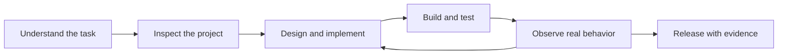

# Apple Blueprint

**Design with intent. Build natively. Verify with evidence.**

Apple Blueprint helps Codex work on Swift apps across macOS, iOS, iPadOS, watchOS, tvOS and visionOS. It connects platform guidance, focused design reviews and local inspection tools into one engineering workflow.

**Release: 2.0.0-alpha.6 · public alpha · Node.js 22+**
Independent project; not affiliated with or endorsed by Apple.



## What you can do

| Your task | Blueprint helps with |
| --- | --- |
| Build an Apple app | Swift architecture, concurrency, persistence and platform-specific interactions |
| Improve an interface | Hierarchy, typography, accessibility, motion and native controls |
| Investigate stutter | Separate app rendering, GPU work, capture transport and input latency |
| Work with a real iPhone | Device identity, trusted automation, bounded capture, idle pause and evidence |
| Review payment returns | Browser-to-app handoff, authoritative payment state and duplicate-credit checks |
| Prepare a release | Source-bound build evidence, explicit acceptance gates and rollback planning |

## Start here

Install this repository's Apple plugin using your Codex plugin installation interface, selecting `plugins/apple`. The plugin requires a local executor; installation capabilities depend on your Codex host. Do not assume that copying files registers a plugin or connects MCP.

After installation, ask:

> Use Apple Blueprint to inspect this project, improve its native navigation and verify the changed behavior. Keep device tests separate from local tests.

To inspect the helpers directly, run from this plugin directory:

```sh
node skills/apple/scripts/apple.mjs doctor
node skills/apple/scripts/apple.mjs route "Investigate animation hitches in my iOS app"
node scripts/mcp-server.mjs --stdio
```

No API key or npm dependency installation is required for the core helpers. Xcode and the relevant SDKs are required for Apple builds; hardware, signing and account access are separate prerequisites.

## Local tools

- **apple_route** selects focused references and explains routing.
- **apple_inspect_project** reports project configuration and heuristic findings for review.
- **apple_sha256** computes file integrity hashes; it does not prove signing or safety.
- **apple://registry** exposes routing/provenance; **apple_native_review** supplies a review prompt.

The helpers do not automatically deploy apps, restore devices, sign releases or approve financial transactions. Project source stays local unless you separately authorize a transfer.

## Guides

- [Workflow and practical prompts](docs/WORKFLOW.md)
- [Release status and remaining qualification](docs/STATUS.md)
- [Changes in this release](docs/CHANGELOG.md)
- [Performance and smooth-motion audit](skills/apple/references/smooth-motion-audit.md)
- [Physical iPhone workflow](skills/apple/references/physical-iphone.md)
- [Full verification contract](docs/V3-EXIT-CONTRACT.md)
- [Licenses and upstream attribution](THIRD_PARTY_NOTICES.md)

## Verify this package

From the repository root:

```sh
node scripts/check.mjs
node plugins/apple/scripts/test-swift.mjs
```

The Node suite covers helper behavior, routing, relocation and evidence gates. The Swift sample is synthetic. Neither establishes physical-device smoothness, App Review acceptance or financial correctness.

## What changed in alpha.6

Real-device lessons now inform capture backpressure, serialized input, app activation checks and safe idle behavior. Motion guidance distinguishes native frame pacing from remote-preview speed. Latest-frame mailbox guidance explains how to discard stale video without discarding ordered input.

**The My iPhone controller is a separate application, not bundled here.** Its local queue tests inform these references; the revised controller still needs device qualification. This release does not promise flawless performance or universal platform coverage.

MIT for original material; selected upstream specialists retain their licenses and revision pins.
